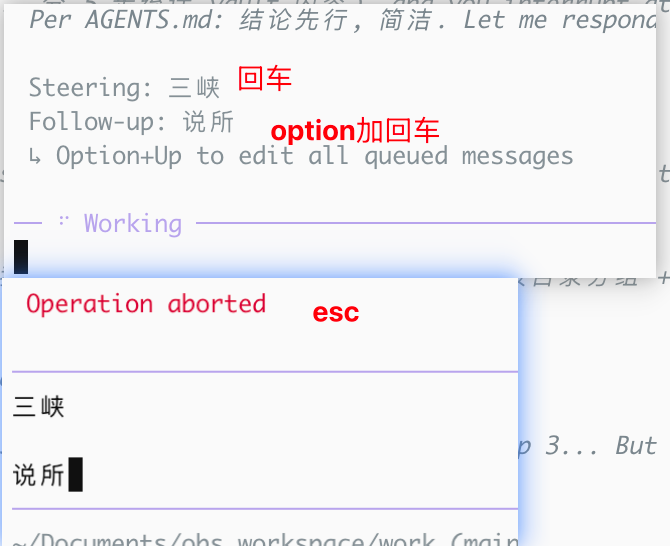
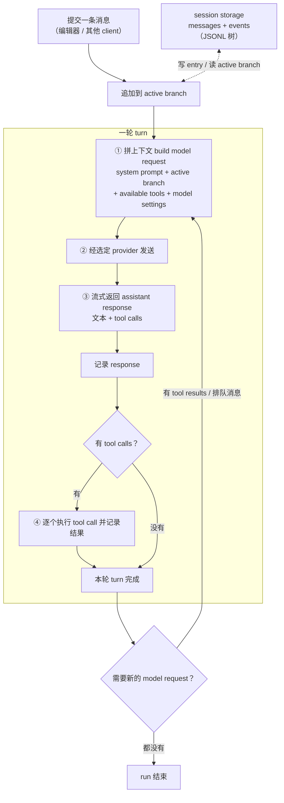
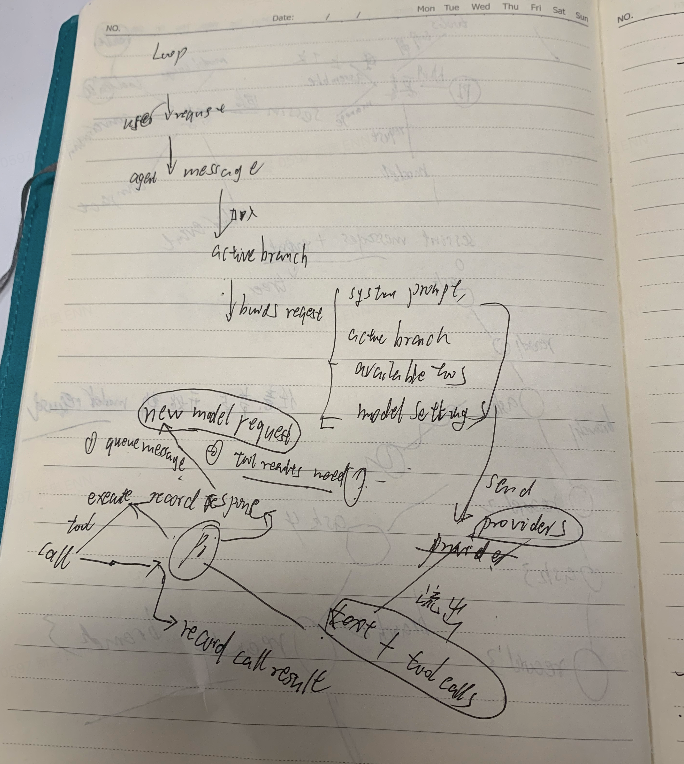
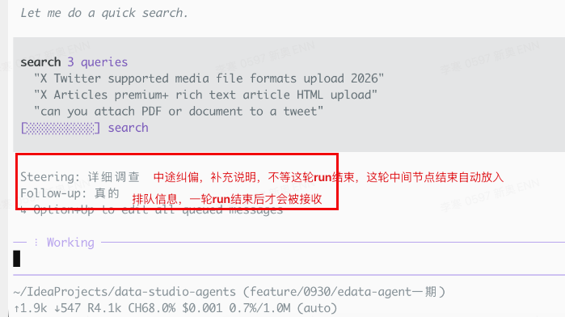
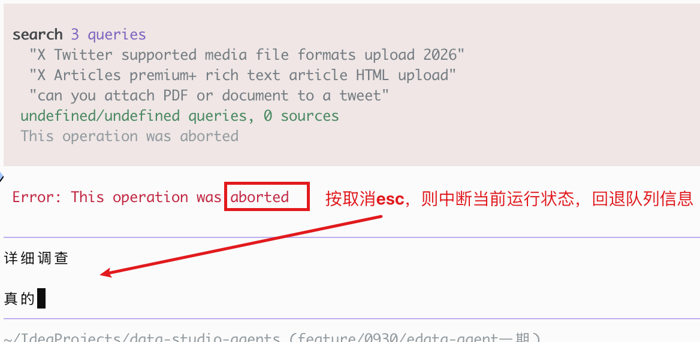
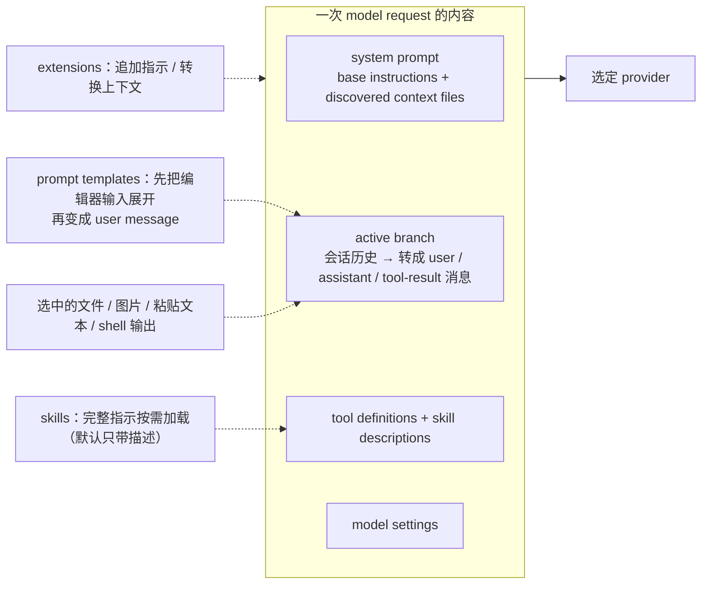
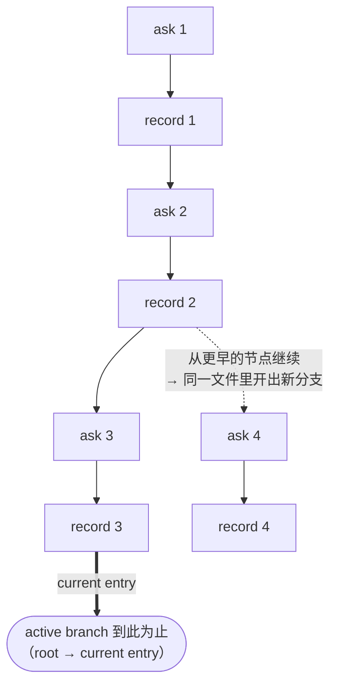
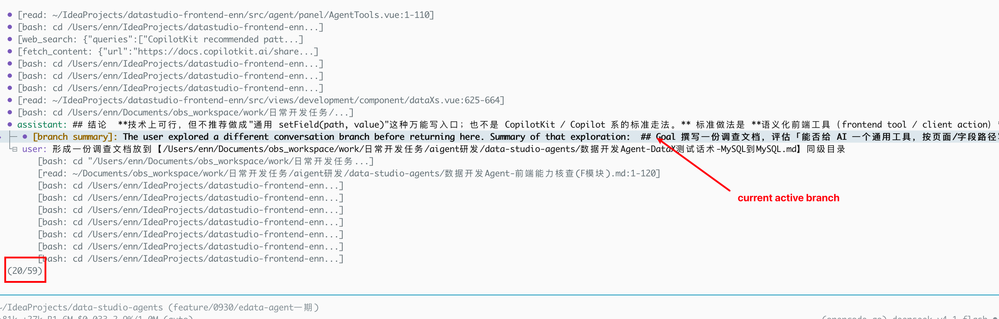

# How Pi Works

> 读 Pi 文档后的原理笔记：一次请求怎么跑、上下文怎么组装、会话树/分支/压缩、五种接口、资源与扩展。

> 来源：https://pi.dev/docs/latest/how-pi-works（本机离线：`/opt/homebrew/lib/node_modules/@earendil-works/pi-coding-agent/docs/how-pi-works.md`）


**一句话**：Pi 协调四件事 —— **model request / 工具执行 / 上下文拼装 / 会话存储**。会话（session）是 Pi 对一段对话的记录，含 messages、tool calls 与结果、model changes、compactions 等事件；这些 messages 与 events 构成一棵**树**，树上每条路径是一个 **branch**，终点是 current entry 的那条就是 **active branch**，它为下一次 model request 提供历史。



## 动图（一次 run 的流转）

- 视频：[`diagram/pi-run.mp4`](diagram/pi-run.mp4)
- 网页版（自动播放）：[`diagram/pi-run.html`](diagram/pi-run.html)
- 配置：[`diagram/pi-run.json`](diagram/pi-run.json)

主链路：**用户消息 → active branch → 组装请求 → provider → 流式响应 → 执行工具 → 记录 → 下一 turn**；侧栏 4 个核心要素轮流点亮。

## 1. Agent loop：Pi 的主循环

Pi 协调四件事：**拼上下文 → 发 model request → 执行工具 → 存会话**，然后围绕它们循环。一张图看完：





- **turn** = 请求 → 流式响应 → 记录响应 → 执行工具 → 记录结果，这一整段。
- **run** = 一个或多个 turn；只要还有 tool results 或排队消息要处理，就再开一个 turn，否则结束。
- 图上的 `②` 每次都从 `①` 重新构建：原文 Sessions 节说 “Model context is reconstructed from the active branch”，所以历史不是缓存下来的字符串。
- 关键顺序：**用户消息先追加进 active branch，再组装请求**（不是"从分支开始拼"）。
- 组装四要素：**system prompt + active branch + available tools + model settings**（模型 / thinking level 也算一项，别漏）。

### 消息的三种进入时机

| 类型 | 什么时候被处理 | 用途 |
|---|---|---|
| Steering messages | 当前 assistant turn 之后 | 中途插队、纠偏（不阻塞当前 turn，但也不用等整个 run） |
| Follow-up messages | agent 把待办全部做完之后 | 排队追加，不打断当前连续工作 |
| Aborting | 立即 | 停止当前 run，并把排队未执行的 steering / follow-up 消息退回编辑器 |



```ad-note
Steering messages enter after the current assistant turn. Follow-up messages enter after the agent has finished its pending work. Aborting stops the current run and returns queued messages to the editor.
```

## 2. Context：一次请求里装什么



**组装结果 = `system` + 活动分支转出的 `user / assistant / toolResult` 消息。**

- `system` **就是 system prompt**，是**独立的 system 角色**，不是"用户消息"；整个请求只有一条在最前。
- **system prompt** = Pi 的基础指示（base instructions）+ 发现的上下文文件（discovered context files；如 `AGENTS.md`）+ 工具定义 + skill 描述（`name + description + path`）。
- **skill 正文不常驻**：命中后才用 `read` 读 `SKILL.md`，读回的文本作为 toolResult 进上下文。
- **条目要先"转换"成消息**才发给模型：

| session 条目 | 进上下文？ |
|---|---|
| `message`（user / assistant / toolResult / system） | ✅ 原样 |
| `compaction` | ✅ 但转成**摘要消息**（不是原文） |
| `branch_summary` | ✅ 转成分支摘要 |
| `custom_message` | ✅ 扩展注入的消息 |
| `usage` / `custom` | ❌ 只记账 / 扩展状态 |
| `context_edit` | ❌ 自身不产生消息（只改别的条目可见性） |

- **prompt template**：编辑器里敲 `/name`，在**变成用户消息之前**展开成文本（不是新能力，只是文本复用）。
- **文件 / 图片怎么进 message content**：图片 = **base64**（`ImageContent`）；文本文件 / 粘贴文本 / shell 输出 = **直接文本**（`TextContent`）。

## 3. Session：会话是一棵树

session 记录的不只是消息：**messages、tool calls 与结果、model changes、compactions、其它事件**都在里面。



- 持久会话就是 **JSONL 文件**：每个树节点有 ID，并指向自己的 parent；current entry 标识出 active branch。
- **"分支"不是被存储的对象**：树里没有 branch 条目；分支 = **当前叶子 → 根** 算出来的路径。换叶子就换分支。
- 从更早的 entry 继续 = 在**同一个文件**里多出一条分支；`fork` / `clone` 则把选中的历史**复制**进**新会话文件**（可带 `parentSession`）。
- model 上下文**每次从 active branch 重建**。
- **Compaction** 插入一条 `compaction` 条目（类型名是 `compaction`，不是 `compact`），在后续请求里**替换**掉更早的消息；但原始条目仍留在 session tree 里（所以压缩不是删数据）。

**`compaction` 条目字段**

| 字段 | 含义 |
|---|---|
| `summary` | 结构化摘要（Goal / Constraints / Progress / Next Steps / Critical Context） |
| `firstKeptEntryId` | **保留边界**：这条起原样发送；之前被摘要替代 |
| `tokensBefore` | 压缩前 token 数 |
| `usage` | 生成摘要这次调用的消耗 |
| `details` | 累计读 / 改过的文件 |

**模型看到的结构（有压缩时）**

```
system → summary → [ firstKeptEntryId … 末尾（含最新用户消息）]
```

即：**摘要放最前**，然后才是 `firstKeptEntryId` 到末尾的原文。多次压缩时，下次从**上一次的 `firstKeptEntryId`** 继续汇总，并带上旧摘要（增量）。



## 4. Interfaces：五种入口，同一套内核

| 模式               | 原文描述                               | 用途（我的归纳）  |
| ---------------- | ---------------------------------- | --------- |
| Interactive mode | 在终端渲染 session 与 agent 事件           | 日常使用      |
| Print mode       | 跑一个 prompt，写出最终响应                  | 脚本里拿结果    |
| JSON mode        | 把 agent 事件写成 JSONL                 | 程序消费事件流 / 排查 |
| RPC mode         | 从 stdin 读 JSONL 命令，向 stdout 写响应与事件 | 非 Node 程序驱动 Pi |
| TypeScript SDK   | 在进程内创建并控制 agent session            | Node/TS 程序里嵌入 Pi |

所有界面共用同一套 **agent 与 session 机制**（差别只在 I/O 形态）。

- **接口 ≠ 扩展入口**：接口是"怎么驱动 Pi"；Extension 是"怎么改 Pi"，**与接口无关**（各模式下都能跑）。
- **SDK 不是写扩展的主力**：写 Extension 用 `ExtensionAPI`；SDK 的主场是"把 Pi 当库嵌进应用"；跨语言用 **RPC**。
- 日常其实只用 Interactive；Print / JSON 偶尔；RPC / SDK 只在外部集成时用。

## 5. Extensions and resources

| 资源 | 是什么（原文） |
|---|---|
| Extensions | TypeScript 模块，加载进 Pi 进程；工厂函数注册 tools / commands / shortcuts / providers / event handlers / renderers / terminal UI |
| Skills | 按需的指示 + 附属文件（on-demand instructions and supporting files） |
| Prompt templates | 可复用的消息文本（reusable message text） |
| Themes | 终端配色（terminal colors） |
| Pi packages | 用 npm / git 分发上面这些资源 |

**不属于"资源"的**（常见混淆）：
- `AGENTS.md` → 是 **context files（项目指令）**，属 §2 上下文组装；
- **system prompt** → 是**装配结果**，不是资源。

## 6. Trust and permissions

- Pi **先**决定项目信任，**再**加载项目设置与资源；信任决定和项目资源加载之后，才加载上下文文件。
- 启用的工具使用 **Pi 进程的操作系统权限**；extensions 也在该进程内执行。
